# CaYaDev MilkDrop Presets

Original MilkDrop presets made for [CAYADEV Visualizer](https://github.com/CaYatur/SoundVisualizer). They are
built into the app, and you can also use them in any MilkDrop-compatible player.

Every preset here was written from scratch (no code from community presets) and checked before it was added:

- **Shaders:** warp and comp shaders; bass, mids and treble each drive something different.
- **Stability:** 90 seconds of looped music without fading to black, washing out to white, or freezing.
- **Speed:** 60 fps at 1080p on an entry-level integrated GPU (measured on an AMD Radeon 610M).
- **MilkDrop 2 match:** MilkDrop 2 presets were rendered in MilkDrop 2 itself (the BeatDrop port) and look the
  same as in CAYADEV Visualizer.
- **Refresh rate:** they look the same at 60 Hz and 144 Hz, because trails fade by time, not by frame count.
- **No extra files:** only MilkDrop's built-in noise textures are used, so no texture pack is needed.

## Presets

Each picture is a frame from CAYADEV Visualizer playing music; click it to open the preset file.

<!-- gallery: node scripts/preset-pack.js -->
<table>
<tr>
<td align="center" valign="top" width="33%"><a href="CaYaDev%20-%20Neon%20Monsoon.milk">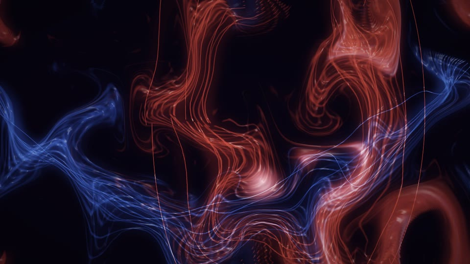</a> <b>Neon Monsoon</b> liquid · MilkDrop 2</td>
<td align="center" valign="top" width="33%"><a href="CaYaDev%20-%20Event%20Horizon.milk">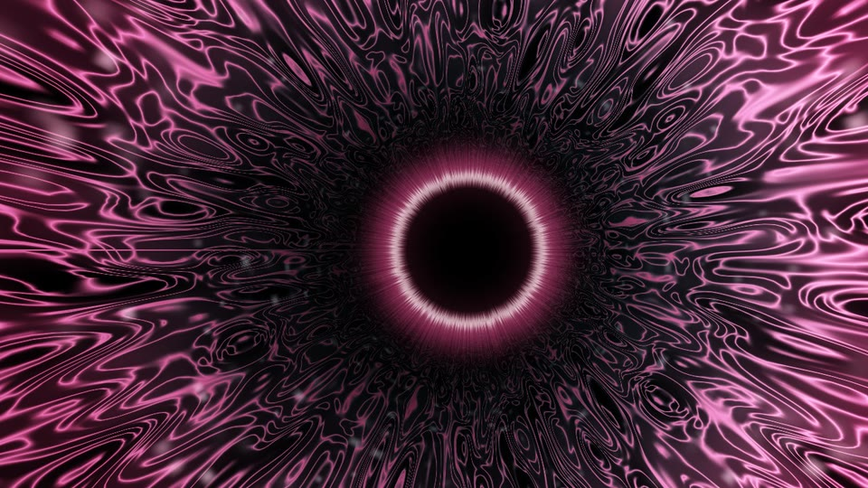</a> <b>Event Horizon</b> tunnel · MilkDrop 2</td>
<td align="center" valign="top" width="33%"><a href="CaYaDev%20-%20Prism%20Lattice.milk">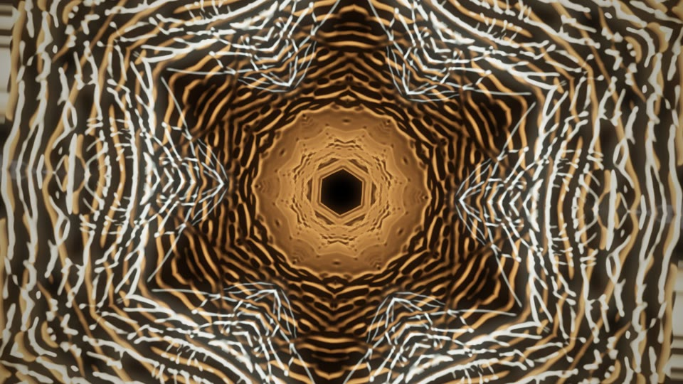</a> <b>Prism Lattice</b> geometric · MilkDrop 2</td>
</tr>
<tr>
<td align="center" valign="top" width="33%"><a href="CaYaDev%20-%20Northern%20Veil.milk">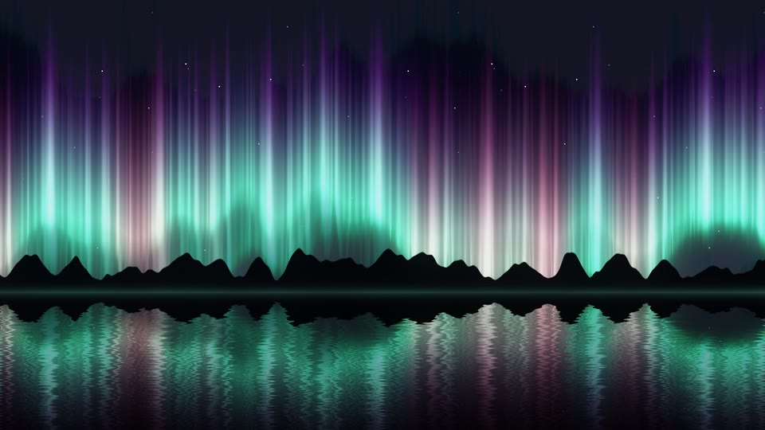</a> <b>Northern Veil</b> ambient · MilkDrop 2</td>
<td align="center" valign="top" width="33%"><a href="CaYaDev%20-%20Twelve%20Moons.milk">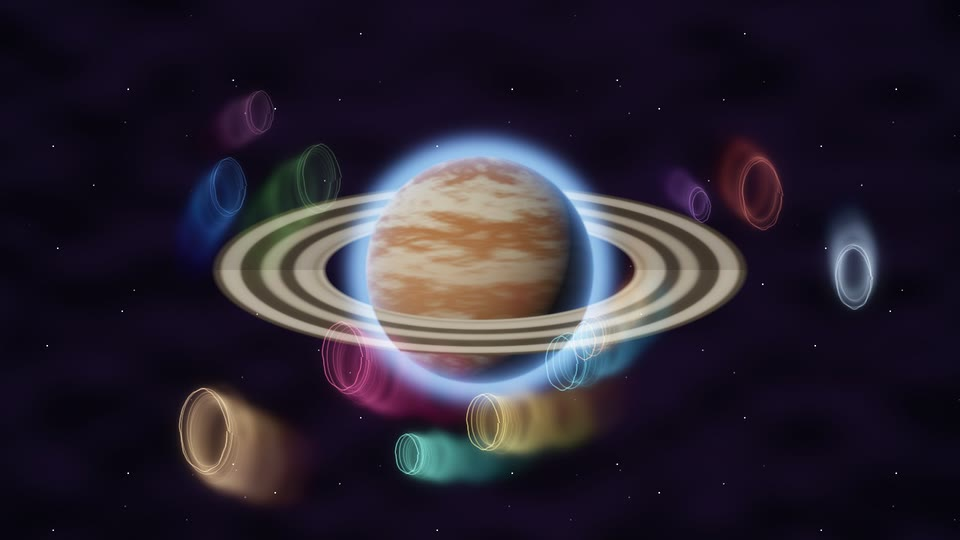</a> <b>Twelve Moons</b> space · MilkDrop 3</td>
<td align="center" valign="top" width="33%"><a href="CaYaDev%20-%20Phosphor%20Scope.milk">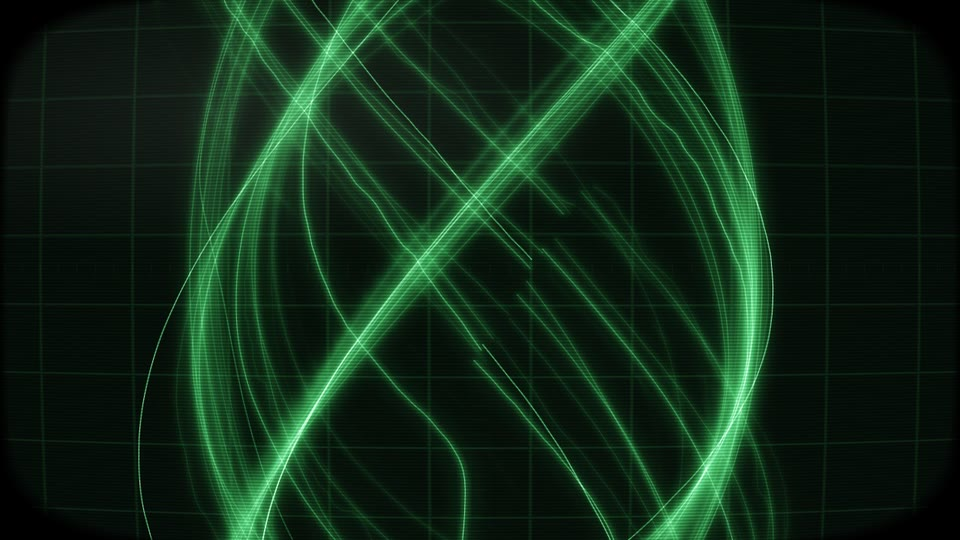</a> <b>Phosphor Scope</b> retro · MilkDrop 2</td>
</tr>
<tr>
<td align="center" valign="top" width="33%"><a href="CaYaDev%20-%20Synthwave%20Horizon.milk">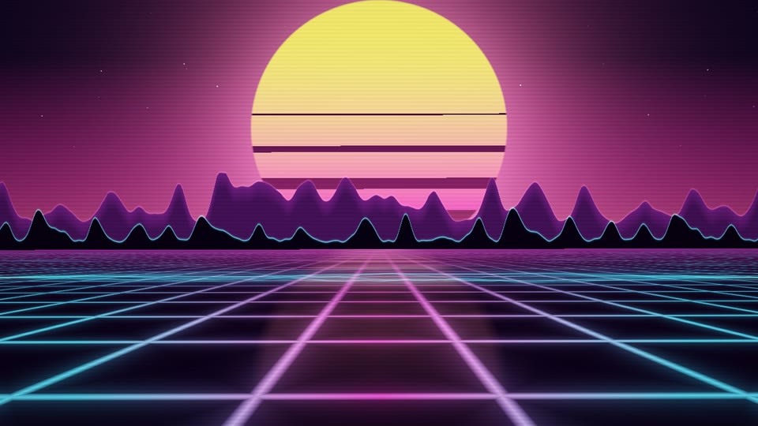</a> <b>Synthwave Horizon</b> retro · MilkDrop 2</td>
<td align="center" valign="top" width="33%"><a href="CaYaDev%20-%20Coral%20Script.milk">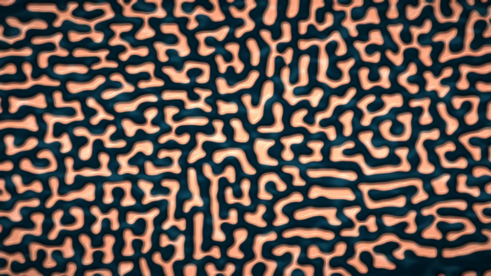</a> <b>Coral Script</b> organic · MilkDrop 2</td>
<td align="center" valign="top" width="33%"><a href="CaYaDev%20-%20Hyperlane.milk">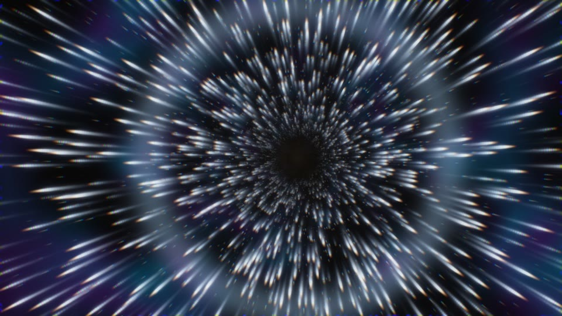</a> <b>Hyperlane</b> space · MilkDrop 2</td>
</tr>
<tr>
<td align="center" valign="top" width="33%"><a href="CaYaDev%20-%20Cymatics.milk">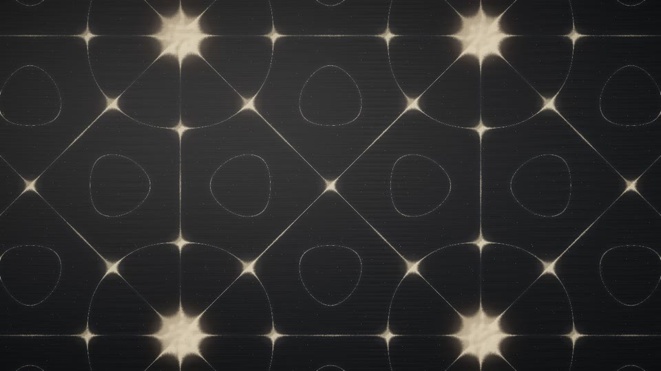</a> <b>Cymatics</b> geometric · MilkDrop 2</td>
<td align="center" valign="top" width="33%"><a href="CaYaDev%20-%20Ember%20Storm.milk">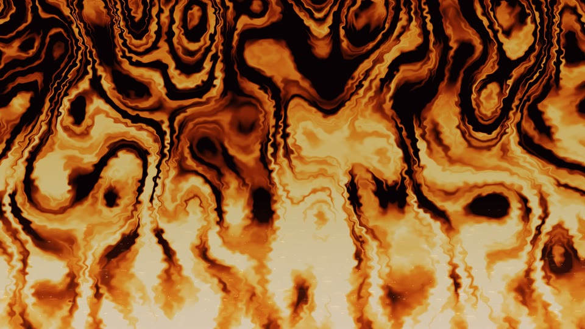</a> <b>Ember Storm</b> organic · MilkDrop 2</td>
<td align="center" valign="top" width="33%"><a href="CaYaDev%20-%20Kintsugi.milk">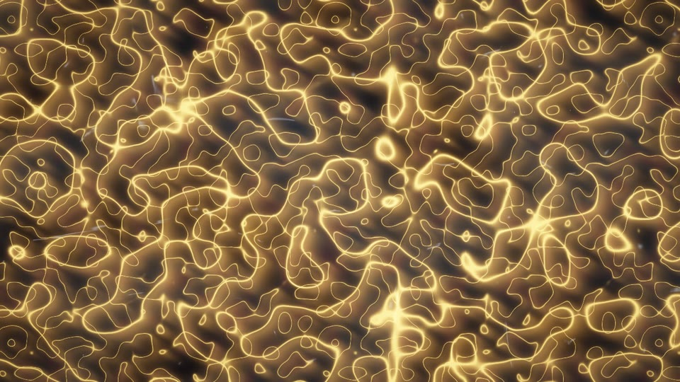</a> <b>Kintsugi</b> abstract · MilkDrop 2</td>
</tr>
<tr>
<td align="center" valign="top" width="33%"><a href="CaYaDev%20-%20Laser%20Cathedral.milk">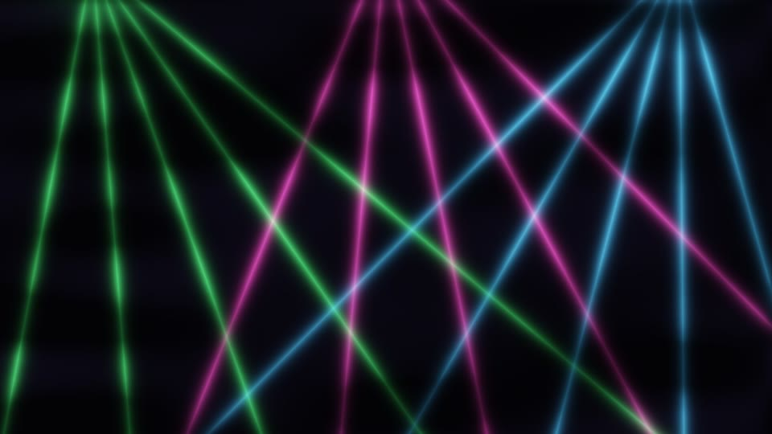</a> <b>Laser Cathedral</b> club · MilkDrop 2</td>
<td align="center" valign="top" width="33%"><a href="CaYaDev%20-%20Julia%20Bloom.milk">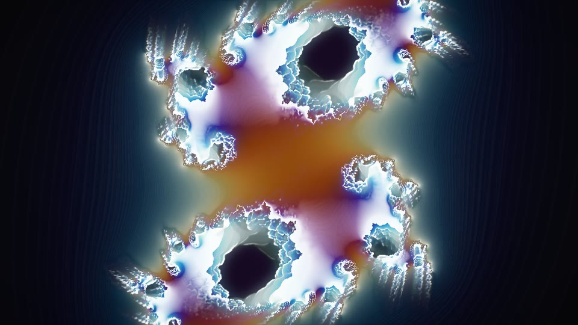</a> <b>Julia Bloom</b> fractal · MilkDrop 2</td>
<td align="center" valign="top" width="33%"><a href="CaYaDev%20-%20Night%20Bloom.milk">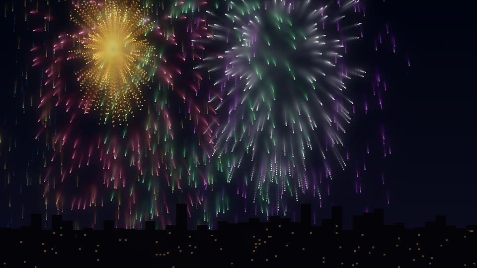</a> <b>Night Bloom</b> space · MilkDrop 3</td>
</tr>
</table>
<!-- /gallery -->

**MilkDrop 3** presets use more than four custom waves or shapes, or q33–q64. A MilkDrop 2 player loads only
the first four waves and shapes, so these presets show less there. MilkDrop 3 presets were checked in CAYADEV
Visualizer only; MilkDrop 3 itself was not available for testing.

## Using them elsewhere

Copy the `.milk` files into your player's preset folder:

- MilkDrop 2 / BeatDrop / Milkwave: the `presets` folder next to the player.
- projectM: the preset directory from its settings.

Most files have `PSVERSION=3`, which in MilkDrop 2 means pixel shader 2.x (ps_2_a, or ps_2_b). Synthwave
Horizon has `PSVERSION=4` (pixel shader 3.0) because it needs more constants. Both run on any DirectX 9.0c-class
GPU.

## License

[CC BY 4.0](LICENSE.md): use them anywhere, including commercially, and credit "CaYaDev".
